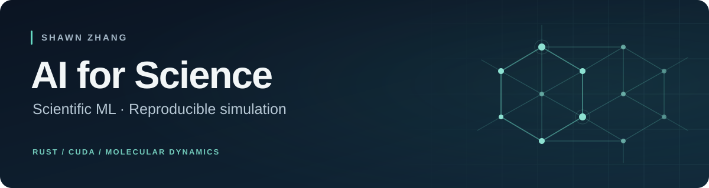

# Hi, I'm Shawn

I work on scientific computing at the intersection of machine learning and molecular simulation. My focus is on **ML interatomic potentials**, **Rust and CUDA**, and **reproducible research workflows**.

## Selected work

### [omniMD](https://github.com/TANG-LAB-WHU/omniMD/tree/shawn_dev) · ML potentials in Rust

My development work in the **TANG-LAB-WHU** repository brings together native Rust `se_e2_a` potentials, CPU training, and molecular dynamics, with DeepMD C API integration and a bounded native CUDA inference path.

The implementation supports a documented model subset and is under active development. GPU training is not implemented; performance depends on the workload.

[Development branch](https://github.com/TANG-LAB-WHU/omniMD/tree/shawn_dev) · [Workflow](https://github.com/TANG-LAB-WHU/omniMD/blob/shawn_dev/mlmd/WORKFLOW.md) · [Validation](https://github.com/TANG-LAB-WHU/omniMD/blob/shawn_dev/mlmd/VALIDATION.md)

### [HAP CO₂ mineralization](https://github.com/TANG-LAB-WHU/HAP_CO2mineralization/tree/shawn_dev) · Scientific workflows

I contribute to this **TANG-LAB-WHU** project exploring CO₂ interactions with hydroxyapatite and related surfaces. The developing workflow connects **CP2K → DeepMD → LAMMPS**, with attention to provenance and reproducibility. Implementation and scientific validation are still in progress.

[Development branch and project overview](https://github.com/TANG-LAB-WHU/HAP_CO2mineralization/tree/shawn_dev)

### [IS390](https://github.com/ShawnZ1438/IS390) · Continual learning

Reproducible experiments on a **synthetic CLEAR-style stream**, with replay and prototype ablations, iNeMo-inspired proxies, and automated reporting.

[Experiment report](https://github.com/ShawnZ1438/IS390/blob/main/deliverables/20260508_delivery/REPORT.md)

## Technical focus

- **Scientific ML:** interatomic potentials, molecular dynamics, and continual learning.
- **Systems:** Rust, Python, and explicit CPU/CUDA execution paths.
- **Reproducibility:** clear data contracts, repeatable experiments, and validation with stated limits.

The first two projects are collaborative lab repositories; the links above point to my development branches.
